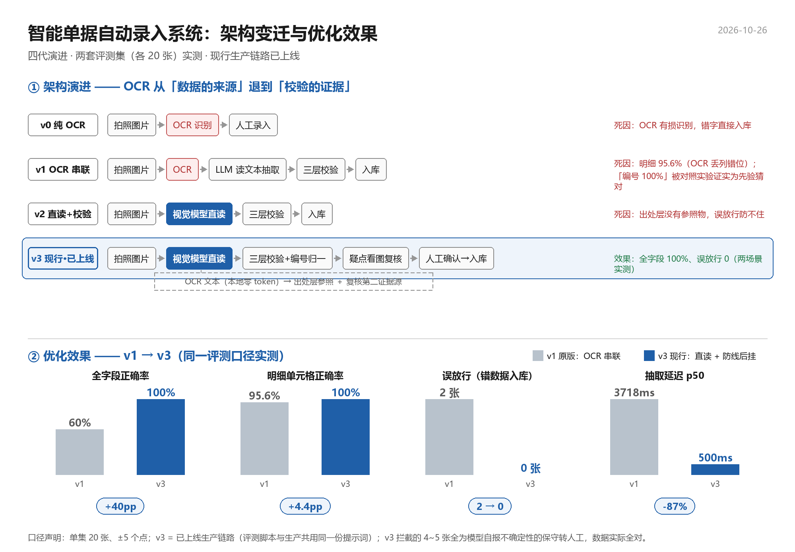

# 智能单据自动录入系统

面向制造业采购场景的单据数字员工：把供应商发来的采购订单 / 到货单（扫描件、传真件、拍照件）读成结构化数据，在**人工确认之后**写入 ERP。

设计前提只有一句：**模型输出一律视为不可信输入，所有判定在服务端重算。**

> 20 张评测集、三条链路：全字段准确率 **100%**、**误放行 0**、抽取 p50 **0.5 s**、约 **1.7k + 0.3k token/张**（口径与失败样本见「评测」一节，不剔除失败样本）。
>
> 本仓库为展示用途，**已移除所有实例凭据**（`WBCS_*` 通过环境变量注入），线上 demo 地址可面谈时提供。

---

## 一、业务流程

```
上传单据 ──► 抽取 ──► 三层校验 ──► 人工确认 ──► 入库 ──► （入库后发现问题）追加更正
              │           │            │           │              │
           图片直读    勾稽/出处/   值必须取自    服务端写    红字冲销，
           服务端固定  格式画像      原文          只许 INSERT  不改原记录
```

关键约束：**人是最后一道闸门，策略是 fail-closed**——宁可拒识、转人工，也不让一条没把握的数据进 ERP。

## 二、架构



四个层次，各管一件事：

| 层 | 职责 | 关键点 |
|---|---|---|
| 接入层 | 标准库 `http.server` 单进程，12 个 API + 单页入口 | 前端只做展示与采集，不做判定 |
| 抽取层 | 图片直读（多模态）+ 结构化输出 | 模型由服务端固定，客户端不可指定 |
| 校验层 | 三层：勾稽 / 出处 / 格式画像 | 第三层拦“模型读错但字面自洽” |
| 存储层 | 两链一视图（append-only） | 哈希由数据库触发器算，改数走冲销 |

## 三、五个关键决策

### ① 模型读图的输出不是结论，是待验证输入

抽取、复核、改数三条链路，结论全部由服务端重算：客户端自报的校验结果、复核目标一律忽略，用哪个模型也由服务端固定。

> 这一条是从事故里学的：早期前端把 23 个多模态模型列成下拉框随便选，实测 `glm-5v-turbo` / `hunyuan-chat` 被图上文字劫持，把供应商改成了清单外的公司名——**“给什么模型、问什么问题”的决定权一旦交给客户端，后面用什么规则都补不回来。**

### ② 四道闸门 fail-closed

入库前四道：无源 → 拒（410）、出处不符 → 拒、复核未过 → 强制转人工、与人工值冲突 → 冲突（409）。人工给的值是硬约束，模型改了会被强制改回。

### ③ 值必须取自原文——提示注入的防线放在结构上

对 33 个模型调用同一条提示注入（10 个接口不兼容、未跑通，**有效 23 个**）：**2 个被改写供应商**（`glm-5v-turbo` / `hunyuan-chat`，把供应商改成了清单外的“鸿运达贸易有限公司”），**2 个数据全对但 `warnings` 为空**（完全没察觉自己被改写），其余 19 个记了 warnings。

后两个才是最危险的——**模型自称“没被劫持”不能作为安全信号**。所以硬防线不放在「检测模型有没有被劫持」，而放在「值必须能在原文里定位到」：

- 边界用随机 nonce 包裹，攻击者物理上构造不出闭合标签；
- 文本字段做标签行对照（实测抓注入相似度 0.48）；
- 数字字段靠勾稽（数量 × 单价 = 金额）兜住。

> 不以“跑了几次没破”当结论：nonce 的 A/B 实测两边都是 0/6，说明这个测试**证明能力不足**，能站住的只有“结构上不可伪造”这一条。

### ④ 「改不了」不等于「不能纠错」——红字冲销第二链

主表 `doc_parses` 只允许 INSERT（哈希由触发器计算），应用层改不动历史。但业务上确实会录错，所以另开一条链：

- `corrections`：只追加更正记录，独立 `seq` / `prev_hash`，自己也是一条可校验的链；
- `v_doc_parses_effective`：按字段 `COALESCE` 最新更正，业务读视图、审计读原表；
- `doc_no_profiles`：工厂级编号档案，是**唯一允许 UPDATE 的表**（它本来就是“当前值”语义）。

代价说清楚：更正不走看图复核，只靠 `reason` / `corrected_by` 留痕。

### ⑤ 评测集必须能证伪自己

早期评测得出“OCR 编号 100% vs 直读 30%”，差得离谱。做控制实验：**同一张图只改真值，OCR 输出一字不变**——说明它从来没读对过，是下游归一按格式画像猜对的，我把“猜对”记成了“准确率”。

修掉评测集的 O/0 同形问题后迁移到直读。落点不是“直读更好”，而是**差距大到不合常理时，先怀疑测量**。

## 四、评测

主集 20 张自造中文单据（多版式 × 多字段标签 × 介质退化），同一批图跑三条链路：

| 链路 | 含义 | n | 全字段 | 自动放行 | 转人工 | **误放行** | p50 |
|---|---|---:|---:|---:|---:|---:|---:|
| A | OCR + 兜底 | 20 | 100% | 95% | 1 | **0** | 0.5 s |
| B | 纯直读（无防线） | 19 | 100% | 84% | 3 | **0** | 4.4 s |
| C | 直读 + 全套防线（= 线上） | 20 | 100% | 85% | 3 | **0** | 4.8 s |

**B 链为什么是 19 张**：有一张的接口调用失败，没有结果就不计入，不补也不删。

另一套 20 张 **O/0 同形集**（真值不在图上，编号字体 O 与 0 像素级同形）：

| 链路 | 全字段 | 编号严格字面 | 编号归一 |
|---|---:|---:|---:|
| A | 100% | 5% | 100% |
| B | 100% | 0% | 100% |
| C | 100% | 0% | 100% |

严格字面率低是**如实暴露**：图上那个字符本身无法区分，任何声称 100% 严格字面的结果，都说明它的评测集没有这个问题而已。归一后 100% 才是这个场景的真实能力。

> 口径提醒：单集 20 张，±1 张 = ±5 个百分点。**单次跑分不作结论**，跨次波动 1~3 张不构成优劣。

## 五、已知未修项

写在这里，而不是等评审翻出来：

| 项 | 现状 | 为什么不修 |
|---|---|---|
| 数据库 RLS 允许匿名读全表 | 未修 | 演示环境，读的是合成数据；生产需改为按租户隔离 |
| 前端导出 CSV 只做引号转义，未处理 `=HYPERLINK` 类公式注入 | 未修 | 影响面是“导出文件在 Excel 里打开”，优先级低于数据正确性 |
| 更正链路没有强制看图复核 | 设计取舍 | 见决策④，靠留痕而非二次校验 |
| 标准库 `http.server` 单进程，无并发压测 | 未做 | 演示规模够用；生产需换 WSGI 并给模型调用加队列 |

## 六、目录

```
app.py                 服务本体，约 1.4k 行，12 个 API 接口
src/                   48 个模块（19 个核心运行 + 评测/生成/探针脚本）
├── ocr.py             本地 OCR（RapidOCR，零外呼）
├── guard.py           校验与闸门
├── grounding.py       出处核对 + nonce 边界
├── validate.py        勾稽与字段规则
├── eval_live.py       打线上接口的评测脚本（服务端自算，可重跑）
└── gen_eval_set.py    评测集生成器（真值在生成时同步落盘，非事后标注）
db/                    两链一视图的建表与迁移 SQL
web/index.html         前端，1.8k 行，无构建步骤
eval/                  评测报告（含失败样本）
testset/               测试集说明 + 8 张自造样图
demo/                  架构图与取证图
```

## 七、运行

需要：Python 3.10+、模型服务凭据、云数据库。

```bash
pip install -r requirements.txt   # 见文件内注释，OCR 依赖需单独装
export WBCS_ENDPOINT="https://<your-deployment>"
export WBCS_PUBLISHABLE_KEY="wbpk_<your-key>"
export EXTRACT_MODEL="deepseek-v4.1-flash"
python app.py
```

缺失配置会在启动时直接报错退出，不会拖到第一次调用模型才失败。

## 八、数据来源

- 自造中文单据：`src/gen_cn_po_variants.py` 生成，仿国内 ERP 打印样式 + 传真/复印退化，**无真实企业数据**。
- 外部公开样本：[`AyoubChLin/Company-document-dataset-v2`](https://huggingface.co/datasets/AyoubChLin/Company-document-dataset-v2)，**Apache-2.0**，数据集自带 `synthetic` 标签（未随仓库分发，按需自行下载）。

## 九、许可

代码用于面试评审与技术交流。除面试评审外的使用，请先联系作者。
